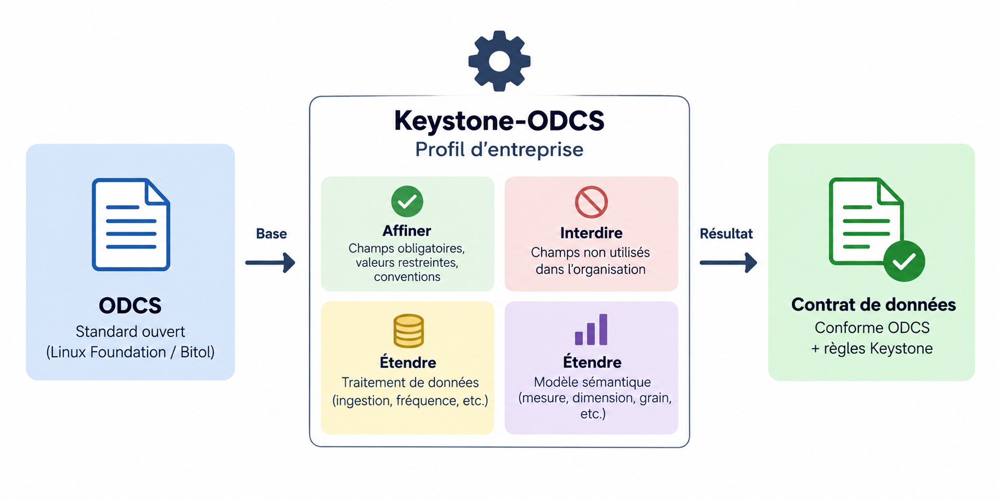

# Keystone ODCS

> *An opinionated ODCS profile: fine-tuned and trimmed fields, plus extensions for data
> processing and semantic modeling — still 100 % ODCS-compliant.*

Keystone est un exemple de profil ODCS : un projet pour illustrer comment adapter un standard
ouvert de contrats de données, l'[Open Data Contract Standard (ODCS)](https://github.com/bitol-io/open-data-contract-standard),
en standard maison, sans le casser.

Il n'est pas fait pour être utilisé tel quel.



## Pourquoi

ODCS est volontairement ouvert : beaucoup de champs optionnels, des énumérations larges, des blocs
pour tous les cas. Une organisation a besoin de l'encadrer : ce qu'elle exige, ce qu'elle
interdit, ce qu'elle ajoute.

Utiliser ODCS tel quel laisse chaque équipe l'interpréter à sa façon. Le forker coupe de
l'écosystème du standard. Reste une troisième voie : **un profil**.

## Un profil, pas un fork

**Tout contrat conforme au profil est un contrat ODCS valide.**

- Le profil **restreint** ODCS : champs obligatoires, énumérations réduites, conventions.
- Le profil **étend** ODCS uniquement par `customProperties`, le mécanisme prévu par le standard.
- Le profil ne **contredit** jamais ODCS : pas de champ renommé, pas de sémantique détournée.
- Le schéma JSON officiel d'ODCS est repris tel quel, sans modification.

## Ce que doit faire un profil

| Axe | Idée |
| --- | --- |
| Affiner | Rendre obligatoire ce qu'ODCS laisse optionnel : description, owner, classification, conventions de nommage |
| Interdire | Exclure les blocs qu'on ne gouverne pas : pas de processus, pas de promesse dans le contrat |
| Traitement de données | Décrire comment la table est alimentée : mode de chargement, fréquence, partitionnement, fraîcheur |
| Qualité de données | Imposer des règles minimales via le bloc `quality` natif d'ODCS : unicité de la clé, non-nullité des champs critiques |
| Modèle sémantique | S'appuyer sur les champs natifs d'ODCS et n'ajouter que ce qui manque : mesures, dimensions, grain, métriques |
| Agent sémantique | Rendre le contrat lisible par un agent IA : définitions métier, métriques et relations assez précises pour qu'il interroge les données sans deviner |

## Comment ça marche

**keystone-odcs** est un projet de démo qui illustre une approche modulaire et réutilisable de la
validation ODCS.

Les règles spécifiques au profil sont centralisées dans une bibliothèque unique, indépendante de
leur mode d'exécution. La CLI n'est qu'une interface parmi d'autres : un pipeline CI/CD, une API
ou un agent IA peuvent exploiter cette même bibliothèque, sans duplication de logique.

Le projet se compose de deux parties :

| Paquet | Rôle |
| --- | --- |
| `keystone-core` | Bibliothèque qui implémente les règles du profil, par-dessus le schéma officiel d'ODCS |
| `keystone-cli` | Client en ligne de commande qui valide un contrat avec ces règles |

```console
$ keystone validate contrat.yaml
```

Le validateur distingue deux types d'erreurs : les erreurs **ODCS** (le contrat n'est pas un
contrat ODCS valide) et les erreurs **Keystone** (le contrat est valide ODCS, mais ne respecte pas
le profil).

## Développement

Monorepo uv :

```console
$ uv sync --all-packages
$ uv run pytest
```
